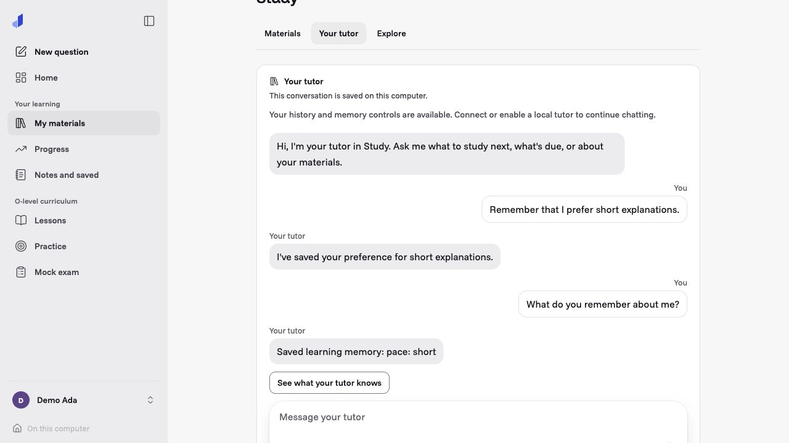
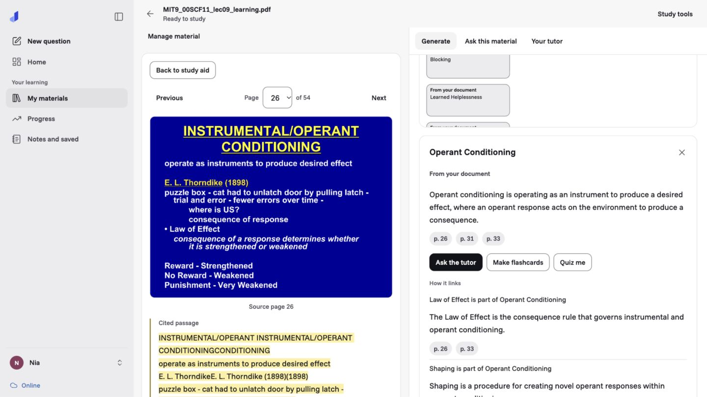
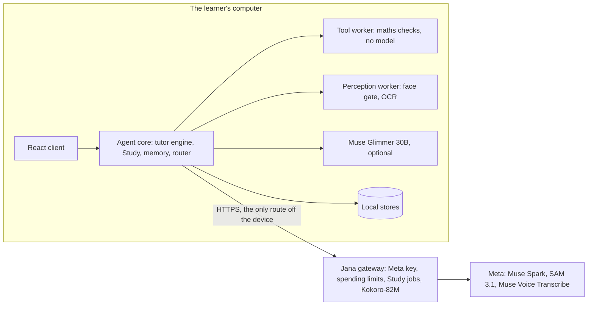
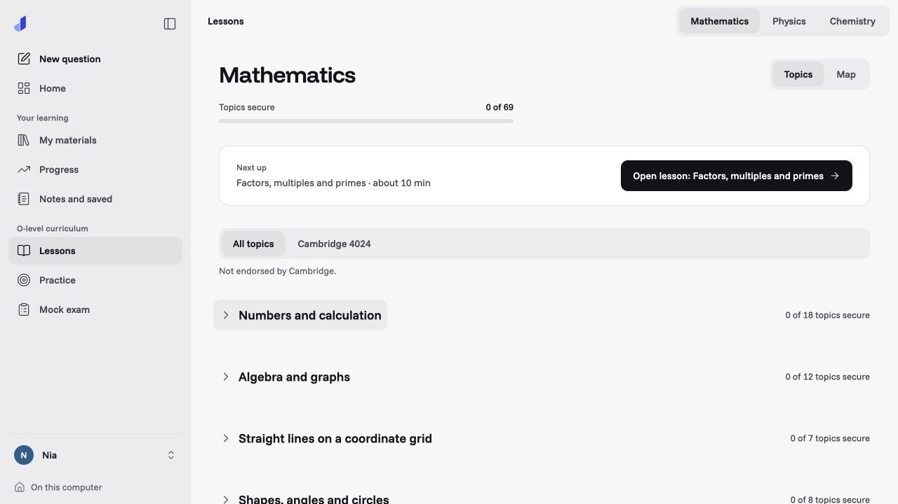
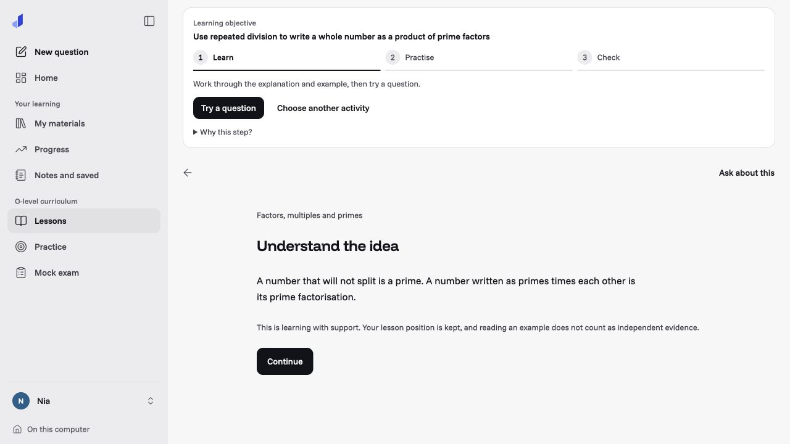

# Jana: a personal AI tutor and study companion for adults

[Architecture (PDF)](ARCHITECTURE.pdf) · [HTML reference](ARCHITECTURE.html)

The architecture explains how Jana uses Meta models, coordinates its agent roles, checks outputs and manages learner
memory and cloud/local routes. Code excerpts and test evidence show the implementation behind those capabilities.

Jana helps adults (18+) learn from their own lecture slides, notes and documents: explore concepts, ask questions,
practice a distinction, and check the original source. The Study workspace supports university material as well as
foundational study; the current demo uses MIT OpenCourseWare's university psychology lecture on learning.
Supported input formats and extraction limits apply; Jana does not promise to understand every file or subject.

Jana also includes authored **O-level Mathematics, Physics and Chemistry** curriculum packs: structured lessons,
worked examples, practice, hints and mock papers stored on the device. These packs are one content offering, not a
limit on what adults can bring to Study, and are not an all-level university curriculum.

Muse Spark powers cloud tutoring and Study generation. Muse Glimmer provides a local-model path on suitable hardware.
Code checks mathematical results before accepting them, and flags unverified results. Saved Study tools and authored
curriculum remain useful without cloud generation. See [Download and run offline](#download-and-run-offline) for the
current launcher requirements, reproducible checks and local-model reliability limits.

## A personal tutor that continues with the learner

**Your tutor** in Study is a persistent conversation for the open learner profile. Returning learners can reopen
that thread and its history, rather than start from an empty conversation. Jana keeps a rolling summary and uses
application-controlled tools to bring relevant learning records into a turn. A daily episode is part of the same
profile's continuing thread, not a new shared conversation for everyone on the computer.

| What Jana can use | How it supports the learner | Control and limits |
| --- | --- | --- |
| Explicit learning preferences | Shorter explanations, a hint first, or a worked example before practice | Learner-selected preferences, not inferred learning-style labels |
| Prior attempts, progress and study plans | Suggest a next activity and explain the evidence behind a recommendation | Counts and progress facts come from code; reading a lesson is not proof of mastery |
| Saved conversation history and its rolling summary | Continue an earlier topic or agreement after returning | Bounded, profile-scoped context; retention and forgotten-memory boundaries still apply |
| The learner's saved materials and source revisions | Find a relevant passage and open the cited source | Only permitted material context is used; uploaded content is treated as evidence, not instructions |

The learner can **remember, correct, forget and inspect** what is saved. For example, in Your tutor:

```text
Remember that I prefer short explanations.
Actually, I prefer normal explanations.
Forget my preference for normal explanations.
What do you remember about me?
```

Supported preference commands are interpreted and committed locally, even without a language model. Free-form
learning notes are different: an explicit note request needs a local memory model and is acknowledged as queued
until checked and saved. If memory saving is off or the request cannot be saved, Jana says so. **What your tutor
knows** shows preferences and learning records, with controls to change them. Forgetting a saved preference/note
excludes it from future memory recall; it does not erase the original visible conversation history.

This is **application memory supplied as context**, not training or fine-tuning the model's weights. The application
controls profile ownership, memory reads/writes, summary folding and evidence checks; a model cannot make a save real
just by saying "I've remembered that." Personalization can shape wording and next-step suggestions, but is not a
measured learning-outcome claim.

**Storage and continuity.** The learner's thread, preferences and learning records are stored locally. Keep the same
data directory and its encryption-key directory across restarts, as described in the [offline guide](#download-and-run-offline).
Available history remains readable without a model; a fresh conversational reply still needs a working cloud or
local model. Restart/next-day continuity and memory-control tests use synthetic learners and scripted providers;
real local-model reliability limits are documented below.

**Cloud context is separately controlled.** Enabling the cloud tutor does not automatically enable **Personal tutor
memory online** or **Online Study materials**. Tutor notes and permitted evidence are filtered under the memory
consent, which is off by default; material excerpts need Study consent. Past raw dialogue stays local, including
when memory sharing is enabled. Context is filtered again when permissions or the active profile change. A cloud
reply therefore may not recall an earlier local-only agreement. Ordinary current messages sent to an enabled cloud
tutor still leave the device for that request; local storage is not a claim that all tutoring happens locally.



*Actual app with a synthetic adult learner; the save and inspection replies are deterministic local memory commands,
not new model inference. Other profiles have their own threads and records.*

[Open the complete memory-inspection screen](assets/readme/personal-memory.jpg) to see the saved explanation-length
preference and editable controls. The displayed learning record is synthetic and does not establish educational gains.

Implementation and regression evidence: [Companion](services/agent-core/agent_core/engine/companion.py),
[memory commands](services/agent-core/agent_core/engine/companion_memory.py),
[history boundaries](services/agent-core/agent_core/engine/companion_history.py),
[restart/continuity tests](services/agent-core/tests/test_companion_continuity.py) and
[memory-control tests](services/agent-core/tests/test_companion_memory_commands.py).

## More ways to study: lectures, sources and the learner's map

- **A YouTube lecture as a Study source.** Paste a YouTube link and its transcript (copied from YouTube's panel) and
  Jana returns a teaching outline: the lecture's objectives, worked examples and concepts, each citing a transcript
  line, mapped to the syllabus skills and compared with what the learner already has ("what haven't I got yet?").
  Every moment has an **Open at m:ss** link that opens your browser at that time; there is no embedded player in this
  release. *Privacy:* nothing is downloaded and Jana opens no connection to YouTube; the transcript is your own
  copy for private study, sent to the gateway only when you have allowed online Study materials.
- **The learner's map.** Progress opens on a map of every installed subject, with Mastery, Freshness, Mistakes, Study
  and Notes layers, marks for what moved since last time, and a time scrubber that replays your record to an earlier
  date (up to 26 weeks), read-only. *Privacy:* it is drawn on the device from your own record, calls no model and sends
  nothing anywhere.



*Actual Study source-check capture from the demo, using a synthetic adult profile. The concept explanation opens
page 26 of the original lecture beside its extracted passage. This screenshot shows source inspection, not a claim
that a new local-model response was generated. Lecture: John Gabrieli, MIT 9.00SC Introduction to Psychology,
Fall 2011, [Lecture 9: Learning](https://ocw.mit.edu/courses/9-00sc-introduction-to-psychology-fall-2011/resources/mit9_00scf11_lec09_learning/),
CC BY-NC-SA. No MIT affiliation or endorsement.*

The current short demo follows an adult learner through a 54-page MIT psychology lecture: concept map, explanation,
source checks, quiz feedback, then saved Study tools during a Jana-only cloud interruption. It demonstrates saved
offline study, not a fresh Glimmer reply. Earlier Physics and Companion rehearsals cover different product paths.

## Hackathon contribution

Jana started on **8 October 2026**. Its earlier tutoring engine, authored curriculum packs, desktop shell and
maths/unit-checking tools were imported into this repository on **25 October 2026**, as baseline commit `7cf6c6ed`.
The work below was recorded after that baseline. Some of it, including the first Muse Spark integration, SAM 3.1
photo outlines and several teaching features, was committed before the event's listed opening, as set out below:

- **Muse Spark cloud integration** (October 26): moved the tutor's diagnosis, solving, checking and coaching
  roles onto Spark through the budgeted gateway (`4e299cdc`). The tutoring engine and maths tools existed before
  this integration. Per-role reasoning settings and parallel diagnosis/solving reduced the measured cloud-turn
  latency in the development harness (`bec8668c`, `42deab1b`).
- **Photo feedback and diagram exercises** (October 26): SAM 3.1 outlines the regions Spark identifies on a
  learner's photo, supports pointing at a line of working and checks taps against a diagram's outlines. The new
  sketch-reading path compares supported photographed sketches with checked figures (`c232ada4`, `244203ee`,
  `e69381d4`). Unread regions are labelled rather than treated as checked.
- **New teaching interactions** (October 26): checked figures in lessons and questions, tracing a misconception
  to an earlier skill, explaining a skill back before mastery where supporting key points are authored, and
  predict-before-you-see Physics simulations (`ea598fb5`, `16b25f12`, `b3dbe87a`, `c2a4d0eb`). These extend the
  earlier curriculum and checking engine; the explain-back content does not yet cover every skill.
- **New curriculum content and distribution** (October 27–November 1): added the projectile-motion subtopic,
  including a lesson, skills, worked examples, misconceptions and practice items (`4ccd5c4c`), and included the
  existing Chemistry pack in the submission build by default (`e0fb8844`). The earlier subject packs remain prior
  work; this does not claim the whole curriculum was authored during this period.
- **Subject concept maps** (October 26): connect the installed curriculum's skills with the learner's questions,
  mistakes and prerequisite gaps, including a highlighted path to an earlier skill (`b5248d8e`, `017f0d3c`).
- **Document and topic concept maps** (October 26): generate concepts and relationships with source-support
  checks and preserved quotations, retain learner edits, and offer concept-focused explanations, flashcards and
  quizzes (`e4b7e741`, `3dacb966`). Unsourced topic maps are labelled separately. This document-map path appears
  in the psychology recording.
- **Muse Glimmer local integration** (October 27): local model discovery, llama.cpp launch with the vision
  projector and optional draft model, and cloud/local routing (`5f9508e5`, `001166e9`, `33efb048`, `c6b07c09`).
  Earlier Jana already supported optional local inference. The Glimmer integration has its own hardware and
  reliability limits; see the offline guide for the tested text path and limitations.
- **Voice integration** (October 27): streaming Muse Voice Transcribe input, subject-specific keyword hints and
  Kokoro-82M speech for accepted replies; Study podcasts also use Kokoro (`278f59e3`, `7cb44a81`, `b18fa80f`).
  Kokoro is a separate, non-Meta model.
- **Research agent and study-pack workflow** (October 27): a short conversation produces an editable brief for
  approval; gateway jobs search and fetch sources, checkpoint progress and resume; cited results become a Study
  pack and concept map (`9ec3e2d4`, `c83f1e14`, `c1350ecb`, `2ee3b300`, `5ecb6d7c`).
- **Adult product and onboarding** (October 26–27, simplified November 1): adult-focused profiles and wording,
  age enforcement in the API and engine, and an age field instead of a date of birth (`3bc030db`, `64730c88`,
  `a662c300`). These are product changes alongside the model integrations.
- **Personal Study companion** (October 29–30): the new **Your tutor** conversation, daily episodes, rolling
  summaries, tools for study, research, planning and progress, and Study activity connected to the learner record
  (`7a92235d`, `aed35cbf`). The work adds personal-tutor memory consent, check-ins and controls while building on
  the earlier learner model, notes and Reflector; persistent memory was not created from scratch here.
- **Lecture-video study** (October 31): YouTube transcript-linked teaching outlines, lecture moments and links
  from the tutor back into the source material (`b814436d`).
- **Learner progress map** (October 31): layers for learning evidence, Study material and tutor notes, changes
  since the last visit and a history scrubber that reconstructs the map at an earlier date (`b814436d`). This is
  distinct from the document concept maps shown in the recording.
- **Rebuilt Study screens** (November 1): the original-PDF reader, library tabs and simpler tool selection
  (`6ab54e13`), followed by a focused Study chat and quiz interface (`7844132a`). Study aids also record and show
  whether they were made online or on the device and which model served them (`f0b862f2`). These changes build on
  earlier material-ingestion, citation, quiz-marking and storage foundations.
- **Broader own-material study** (November 2–4): own-course profiles, sources up to 1,000 pages, online marking
  of written answers and lecture hints (`854298a1`, `584111d0`); scan-reading and job-recovery improvements
  (`816b627f`, `fc7b0ac2`); and further open-material tutoring and saved-quiz verdict fixes (`66e5dc68`).
  The limit is an input allowance, not evidence that every document or every generated claim is correct.
- **Photo screening and consent hardening** (November 2–3): rechecked active Study-material consent before
  excerpts go online (`faea007b`) and revised the local photo gate to use a pinned YuNet face detector
  (`d3e80cdf`). The detector has documented trade-offs and does not identify every photo containing a person;
  these changes strengthen earlier privacy controls rather than introducing consent or screening from scratch.
- **Deployment and integration hardening** (October 28–November 4): stronger numerical and tool-budget checks
  (`29645e3f`, `6777484e`, `74711af7`), plus a hosted review deployment with isolated learner cores and invite-only
  sign-in (`beaa8465`, `76db7b9c`). The hosted and local paths have different capabilities; the setup sections
  describe those boundaries. This does not establish a signed desktop release or Windows installer acceptance.

The October 25 baseline imports earlier Jana code without its prior Git history. This repository keeps
three categories apart: the imported baseline; 45 commits after it but before the opening listed on the event page
(October 26, 5:00 PM GMT); and 214 commits after that opening, to `66e5dc68`. Those counts use committer timestamps
(author timestamps give 49 and 210). Timestamps record commits, not when all the underlying work was done.

**Changes visible in the psychology recording.** The recording follows the new document concept-map experience,
original-PDF reader and rebuilt quiz interface within one revised Study workflow. These changes were committed
after the event's listed opening:

| Visible experience | New implementation | Commit evidence |
| --- | --- | --- |
| A lecture becomes a concept map, with explanations tied to its passages | Document concept-map generation and the Study concept-map component | `e4b7e741`, merged in `3dacb966` (October 26) |
| Open the original lecture page alongside the extracted material and citation | The new `StudyPdfReader` and its Study workspace integration | `6ab54e13` (November 1) |
| Work through the conditioning question, feedback and correction in a focused quiz view | The new `StudyQuiz` component and rebuilt Study chat/quiz presentation | `7844132a` (November 1) |

The workflow builds on earlier material ingestion, source/citation records, quiz marking and local storage.
The lecture import provides its starting context. The connection-interruption segment shows the saved document map,
quiz and source pages staying accessible. Fresh Glimmer inference is documented separately in the offline guide.
The persistent **Your tutor** conversation is another new path, documented above; the short recording focuses on the
material-to-understanding workflow.

These are implementation claims, not measured learning gains.
The demo should distinguish this new work from the existing product and identify every human contributor.

## Architecture at a glance



Code decides each step and checks each result, and a model drafts inside the step it is given. The full reference,
with every capability, its status and its limits, is [ARCHITECTURE.pdf](ARCHITECTURE.pdf)
([HTML version](ARCHITECTURE.html)).

## The Meta models and what each does

| Model | Where it runs | What it does in Jana |
| --- | --- | --- |
| **Muse Spark** (`muse-spark-1.3`, Standard mode) | Meta Model API, through Jana's gateway | The tutor's reasoning: the input guard, the Diagnoser (what the learner is stuck on), the Solver and Checker (which call the maths tools) and the Coach (the next hint). Also reads photos of working and diagrams, writes and verifies Study aids, and runs the research agent: web search on the Responses API, every statement checked against the page it cites. |
| **SAM 3.1** | Meta Model API, through the gateway | Turns the regions Muse Spark finds on a photo into exact outlines, so Jana can highlight the line of working where a sign changed on the learner's own photo, and drill the parts of a labelled diagram ("tap the condenser"), marking each tap against the outline. |
| **Muse Voice Transcribe** | Meta Model API (realtime), through the gateway | Hears the learner in cloud voice conversation: endpointing, live partial transcripts and the curriculum's keywords as hints. Every spoken reply still comes from an accepted, checked tutor turn. |
| **Muse Glimmer 30B** | On the laptop (open weights, Apache-2.0), with llama.cpp | Local tutor inference through the same engine and tools; optional vision projector and DFlash draft. Intended for suitable high-memory machines; recent fresh companion turns stalled, so no latency or seamless-fallback guarantee. |

Muse Spark is used in Standard mode only; Contributor mode is never configured. Meta's Model API terms require every
end user to be 18 or over, so Jana asks for an age at sign-up and creates adult profiles only.

Meta offers no text-to-speech model licensed for commercial use, so spoken replies and study-pack podcasts are read by
Kokoro-82M (Apache-2.0).

## How it fits together

```
 Learner (browser host or desktop app)
   │ typed question, photo, voice
   ▼
 Jana engine (services/agent-core, on the device)
   input guard → Diagnoser → Solver + tools → Checker → Coach → release gates
   tool worker (sandboxed maths, units, marking) · perception worker (local privacy pass on every photo)
   │                                                   │ network gone
   ▼                                                   ▼
 Jana gateway (services/cloud-gateway)               Muse Glimmer 30B on llama.cpp
   holds the Meta key, enforces the spending budget,
   minimises what leaves the device, logs no payloads
   ├─ chat and tools     → Muse Spark (api.meta.ai/v1)
   ├─ photos             → Muse Spark reads ⇄ SAM 3.1 outlines (/v1/vision/segment)
   ├─ voice              → Muse Voice Transcribe hears · Kokoro reads accepted replies
   └─ research agent     → Muse Spark on the Responses API with web search, then verification
```

Without a local language model, installed signed content packs still provide: lessons, practice with code-checked marking and
authored hints, mock papers and saved study packs.

## Try the hosted demo

Judges receive a private link, or an invite code to create an account. Either opens Jana online with Muse Spark,
with no install: start from **Demo Ada** to see a synthetic learner's saved work, or add a profile, choose
**My own course and materials** and upload a PDF, slides or notes.
The hosted deployment does not provide local Glimmer, voice or podcasts. See
[hosted deployment instructions](scripts/hosted/README.md) for its setup and boundaries.

## Run it

Requirements (tested on macOS on Apple silicon): Node 24 (`.nvmrc`) with pnpm 10, uv 0.10 (it installs Python
3.12), Rust (`rust-toolchain.toml`) for the desktop shell, and Tesseract for the photo privacy pass
(`brew install tesseract`).

```bash
pnpm install --frozen-lockfile
```

```bash
uv sync --locked --all-packages
```

### 1. Put your Meta Model API key in the keychain

The gateway is the only process that reads the key; the app, its engine and the local model never see it. On macOS,
add a generic password to the login keychain with service `jana-meta.cloud-gateway` and account `meta_api_key`:

```bash
security add-generic-password -s jana-meta.cloud-gateway -a meta_api_key -w
```

(It prompts for the key, so the key never appears in your shell history.) On Linux the gateway reads the Secret
Service entry with the same service and account. A gateway-only `META_API_KEY` environment variable also works.

### 2. Start the gateway

```bash
uv run python -m cloud_gateway --config services/cloud-gateway/deploy/meta-dev.toml --port 8081
```

`meta-dev.toml` is a local development configuration: a hard spending budget (per day, in total and an expiry date),
a ledger kept in `~/.jana-meta/gateway` across restarts, and cloud voice switched on. Set its `[quotas]` to your own
limits and dates before you use it with your own key; the ledger reserves each call's full cost before sending it and
refuses once a limit is reached. The browser host checks the gateway on its port before starting and refuses one that
is not this repository's (it must answer `/v1/ping` with `jana-gateway-version: 1.2`); set `JANA_META_GATEWAY_PORT` if
you do not use port 8081.

### 3. Start the app

```bash
uv run python -m jana_tools.hackathon_dev
```

Open **http://127.0.0.1:5187/**. The first launch builds and verifies the Mathematics, Physics and Chemistry packs from
`content/curriculum` and signs them with the published development key (a few minutes; later launches reuse them).
Create a profile, then in Settings → Online features give your consent to the cloud tutor.

For a rehearsal without development reloads, use a stable build and a separate synthetic profile directory:

```bash
uv run python -m jana_tools.hackathon_dev --stable --port 5197 --data-dir /tmp/jana-demo
```

Open **http://127.0.0.1:5197/**. Keep the same directory when restarting to verify continuity. With cloud tutoring
off and no local model, saved history, explicit memory commands and authored practice remain available; ordinary
AI conversation requires a configured model. Exported profiles include saved learning state by default; raw
conversation inclusion requires separate authorization.
The browser preview has no native folder picker: use the desktop app for profile archive export and restoration.

### Download and run offline

There are three different offline capabilities. A saved quiz being marked is **not** evidence that Glimmer generated
a new response.

| Capability | Without internet after preparation | Needs a local language model? |
| --- | --- | --- |
| Installed authored curriculum: lessons, worked examples, practice, authored hints and mock papers | Available locally | No |
| Previously saved Study quizzes, concept maps, flashcards and source pages | Read/review saved content; quiz marking is local | No |
| New tutor/Companion replies using Muse Glimmer | Local inference path exists; availability and speed need checking on your machine | Yes |
| New Study summaries, quizzes, maps and other AI aids in this browser launcher | Requires cloud generation (`study_offline_enabled=False`) | Glimmer does not enable this path |
| Muse Spark, SAM 3.1, cloud transcription and web research | Require the corresponding online services and consent | A local model does not replace these services |

**Prepare while connected.** Clone the repository, install its pinned dependencies, build the packs once, and download
any model files before disconnecting. The browser host is a local developer build, not a standalone offline installer.

```bash
git clone https://github.com/ruhu-inc/jana-meta.git
cd jana-meta
# Install Node 24, pnpm 10 and uv first, then:
pnpm install --frozen-lockfile
uv sync --locked --all-packages
```

Use the gateway/app steps above for the first launch. Keep a persistent data directory, rather than `/tmp`, for study
across restarts. Replace the home-relative path below with your own location if needed. Keep the data directory **and
its sibling `.browser-data-keys` directory** together; the latter holds local profile encryption keys. Browser preview
has no native profile archive picker; use the desktop app for supported archive export/restore.

**Current startup dependency.** `jana_tools.hackathon_dev` starts a host that always checks a local Jana gateway,
even with `--local-model`. Run the gateway in a separate terminal, bound to loopback:

```bash
uv run --offline python -m cloud_gateway \
  --config services/cloud-gateway/deploy/meta-dev.toml --host 127.0.0.1 --port 8081
```

The supplied config must retain daily and total budget limits and a future `deployment_budget_expires_at`; its
checked-in event expiry is **9 November 2026 UTC**. After that date, set your own authorized dates and spending limits
before launch. Preserve the gateway's ledger; deleting it is not a supported reset. The host requires the gateway's
version header (`1.2`) and budget header and provisions a local device credential in its storage directory. Thus this
launcher cannot currently cold-start with no gateway process or with an expired configuration. The app's own offline
state does not remove that startup dependency.

A **Meta provider key is not required for the gateway's local health ping/device setup**; missing credentials fail
when cloud inference is requested. A no-secret ASGI health check returned 204 with both required headers on 4 November.
That is a component check, not a complete disconnected cold-start test. Cloud use needs your own provider credentials
as described above. Keep them in the gateway only: the launcher strips `*_API_KEY` variables from the app and local
model environment. The gateway may probe upstream reachability, so keep cloud features off when testing local-only use.

For authored curriculum and saved content without fresh AI replies:

```bash
uv run --offline python -m jana_tools.hackathon_dev --stable --port 5197 \
  --data-dir "$HOME/.jana-meta/browser-data"
```

Open **http://127.0.0.1:5197/**, create an adult profile and leave cloud features off. On the first prepared launch,
pack building/signing can take minutes. Subsequent runs reuse the source-keyed cache and installed packs. The public
submission includes Mathematics, Physics and Chemistry; a full development checkout can also seed Accounting, which
is excluded from that submission. The screenshots below show only the three submission subjects.

**Add Glimmer for new local tutor replies (optional).** Get the exact files from
[Meta's official GGUF release](https://huggingface.co/meta-models/Muse-Glimmer-30B-GGUF), not a differently named
quantization:

- Required: `Muse-Glimmer-30B-KQuant-17GB-Q4_K_M.gguf` (about 17 GB decimal).
- Optional beside it: `mmproj-Muse-Glimmer-30B-Q4_K_M.gguf` (about 1.4 GB) for local vision.
- Optional beside it: `dflash-Muse-Glimmer-30B-Q4_K_M.gguf` (about 1.6 GB) for speculative decoding.

Allow roughly **20 GB for the three weights**, plus dependencies, build/cache space and your materials. These sizes
are storage estimates, not the total application footprint. High-memory Apple silicon is the development target;
plan for **32 GB RAM or more**, with room beyond weights for four inference slots, context and the app. This is not a
validated minimum or a promise for every 32 GB machine; lower-memory and other-platform performance is unverified.
Authored lessons and saved tools do not need the 30B weights.

Install a compatible `llama-server` following the [official llama.cpp build instructions](https://github.com/ggml-org/llama.cpp/blob/master/docs/build.md).
The local installed reference is build **11429 / `d81235049`** on Apple silicon. Verify your binary supports `--jinja`,
`--parallel`, `--api-key-file` and, if using the draft, `--spec-type draft-dflash`; current upstream versions may differ.
The launcher manages the private loopback server itself; do not start a second unauthenticated model server.

```bash
llama-server --version
llama-server --help
uv run --offline python -m jana_tools.hackathon_dev --stable --port 5197 \
  --data-dir "$HOME/.jana-meta/browser-data" \
  --local-model "$HOME/.jana-meta/models/Muse-Glimmer-30B-KQuant-17GB-Q4_K_M.gguf"
```

The launcher checks every present weight against its pinned SHA-256 in `scripts/jana_tools/hackathon_dev.py`, never
downloads weights itself, and allows up to five minutes for model loading. Native readiness then checks the tool/chat
template. A health-ready server alone is not evidence of a successful tutoring turn. No `--online-demo` is needed;
that flag records cloud consent for isolated demonstrations and should be omitted for ordinary local use.

**Verify the offline path yourself.** These are reproduction steps, not a claim that all passed in this release:

1. Start both local processes with the same persistent data folder. Open a curriculum lesson, complete one practice
   item and record its feedback. If you want to test saved Study tools, generate them online with consent beforehand.
2. Turn cloud tutoring off in Jana. With Glimmer loaded, wait for the local runtime/readiness indication, then ask a
   fresh tutor question. Confirm a completed reply and local `muse-glimmer-30b` model calls in that run's trace;
   deterministic memory commands, authored hints and saved quiz feedback do not prove inference. Traces can contain
   study content: inspect locally, do not publish raw learner traces.
3. Disconnect external networking for a controlled test while leaving the loopback gateway running. Reopen the
   authored lesson, answer another item, open saved sources/map and try another fresh local question. Check each
   separately. The demo interrupted only Jana's gateway, with Mac Wi-Fi left on; it proves saved Study continuity.
4. Restart the app and gateway with the same data/key folders while still disconnected and config unexpired. Check
   the same learner's attempts and saved tools. A full disconnected restart is **not yet verified** here.
5. Restore connectivity, turn on cloud features only with consent, and check a new cloud request. Check the displayed
   route and persisted model trace instead of assuming a network indicator proves the provider used.

**Observed local-model checks and limits.** On 4 November, the Companion was fixed to apply its role's output
budget and keep replies complete at the display boundary. Real-model checks ran on revision `66e5dc68` plus that
uncommitted fix through Jana's local API, with the browser settings, a synthetic adult own-course learner and one
ready text source. Three fresh Glimmer replies completed with full sentences, including a source-based follow-up
and a continuation after a core restart on the same learner thread. They used **3, 2 and 2 local calls**, with no
cloud provider configured, and took approximately **87, 58 and 45 seconds**. All seven requests carried the role's
output cap plus the configured reasoning allowance. This small sample is not a latency guarantee.

The fix passed **121 focused regression checks** in its isolated checkout. Its seven new regressions also passed in
the main checkout after applying the narrow change. Nine desktop runtime-supervisor tests passed separately. These
are API and component checks, not an installed Tauri release, Windows-installer test, local-image-inference check or
fully disconnected cold-start qualification. Mac Wi-Fi was unchanged. The Companion code fixes described here
are local changes pending publication.

Earlier rehearsals stalled, and an exploratory O-level run asked to reopen a source on two follow-ups. The new fix
addresses reply clipping and request budgets; it does not establish that all retrieval cases are resolved or prove
reliable first-send behavior, seamless fallback or learning gains. If a fresh reply stalls, cancel/retry and keep
the authored/saved workflow available; do not present it as successful local inference. For startup failures check the named gateway port, version/budget headers and expiry first. For
model failures check exact filenames/hashes, RAM, compatible flags and readiness logs. Keep `JANA_META_GATEWAY_PORT`
consistent in both terminals if using a different port. Do not use scripted `pnpm dev` replies as model evidence.

#### Included offline curriculum

The submission packs are **O level**, not all levels. Current source coverage includes 65 Mathematics lesson files,
27 Physics lesson files and 43 Chemistry lesson files; file counts describe authored coverage, not learning outcomes
or independent teacher approval. Pack versions and available topics are visible in the app. The material is drafted
with AI and checked by build tools; this is distinct from generating a new personalized model reply.



*Actual local app, synthetic adult learner, three installed O-level curriculum packs. This is authored curriculum;
it is separate from the learner's uploaded lecture material in Study.*



*An installed lesson with authored explanation/practice, captured with Jana's cloud gateway paused. This verifies
local content access, not a fresh Glimmer inference result. [Worked example](assets/readme/offline-worked-example.jpg)
and [locally checked guided practice](assets/readme/offline-practice.jpg) are additional real captures.*

Cloud voice reads replies with Kokoro-82M from a local speech pack (`apps/desktop/dev/speech_pack.py` assembles one;
the gateway's `[voice_tts]` settings say where it is). Without it, typed tutoring, photos, Study and research all
work.

### The desktop app

[`apps/desktop`](apps/desktop/README.md) contains the React interface **and** the native Tauri shell. It is the native
desktop route, including OS keychain integration and profile archive pickers. The browser hackathon host above is a
separate development launch of the shared interface. This guide does not provide or verify a downloadable packaged
installer; source checkout and development tools are required here.

For native development, first run the Vite interface server in one terminal, then the shell in another:

```bash
pnpm --filter @jana/desktop dev
```

```bash
cargo run -p jana-shell
```

The shell supervises its **own** agent core; the Vite server supplies frontend assets. The first command on its own
is a browser development preview and defaults to scripted model replies when no live runtime is configured. These
commands alone do not install Glimmer weights, configure real inference or reproduce the budgeted hackathon browser
host. Authored/saved tools remain distinct from fresh AI replies. Follow the dedicated desktop README and runtime
configuration before treating a native reply as model evidence; native export/restore and offline inference need
their own verification on the actual packaged build.

## Tests

```bash
uv run pytest services
```

```bash
pnpm test
```

```bash
cargo test --locked --workspace
```

The tests need no network and no Meta key, so they spend no credit; the few live checks skip themselves unless asked
for.

## Repository layout

| Path | Holds |
| --- | --- |
| `apps/desktop/` | The app: `src/` (React), `src-tauri/` (Rust shell), `dev/` (the browser host's engine and pack seeding) |
| `packages/` | `ui`, `client-core`, `renderers` (interactive science visuals), `i18n`, `contracts-ts` (generated) |
| `services/agent-core/` | The tutoring engine: roles, release gates, learner model, Study, research and vision on the device |
| `services/cloud-gateway/` | The gateway: Meta adapters (`providers/meta.py`, `meta_responses.py`, `sam.py`, `meta_speech.py`), budget, research agent |
| `services/tool-worker/` | Sandboxed maths, units and marking that every number is checked with |
| `services/perception-worker/`, `services/study-worker/` | Sandboxed photo privacy pass, and document extraction for Study |
| `services/pack-builder/`, `services/signing-service/` | Build, verify and development-sign the content packs |
| `content/`, `skills/` | The tutor's authored rules and prompts, and the curriculum sources of the packs |
| `contracts/` | Public wire contracts; the TypeScript and Python bindings are generated from them |
| `evals/` | Synthetic scenarios, recorded model fixtures and contract corpora the tests use |

## Licences

- Code: [Apache License 2.0](LICENSE). See [NOTICE](NOTICE).
- Content packs (`content/curriculum`): the owner's own licence (`LicenseRef-Own` in each record); not Apache-2.0.
- Third-party components keep their own licences: [THIRD_PARTY_NOTICES](THIRD_PARTY_NOTICES).

## Built with

- **Muse Spark**, **SAM 3.1** and **Muse Voice Transcribe** through the Meta Model API, under the
  [Meta Model API Terms of Service](https://dev.meta.ai/legal/terms-of-service). No Meta model weights are part of
  this repository.
- **Muse Glimmer 30B**, open weights under the Apache License 2.0, downloaded by the user from Meta's release.
- **meta-sam-parser** (Meta's decoder for SAM 3.1's masks), installed from PyPI under the SAM License; a copy of the
  licence comes with the package.
- **Kokoro-82M** (Apache-2.0) for speech, and **llama.cpp** (MIT) to run Glimmer.
